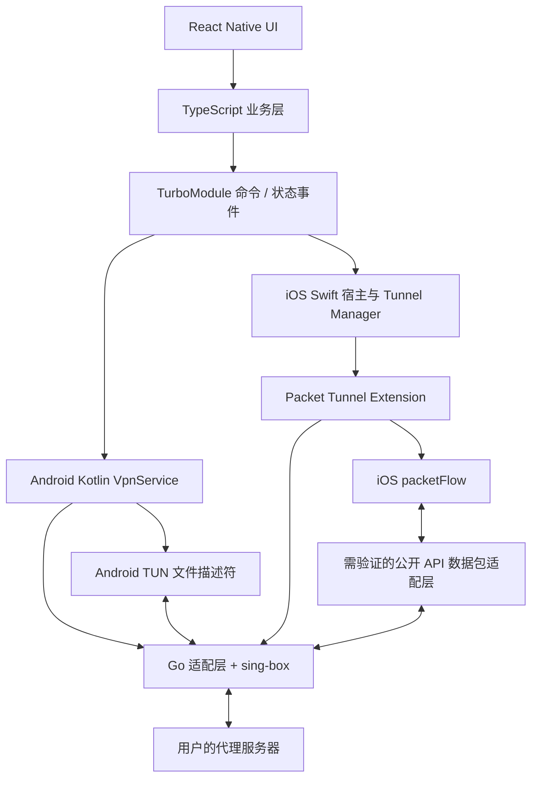

# Hafen 架构与实施计划

确认日期：2026-11-15。产品方向：开源发布，Android 与 iOS 双平台。项目名暂用 Hafen。

当前进度：P0 已通过双端构建与模拟器启动验证；提前完成 P2 中的订阅地址安全存储、去重和删除。
P1 已完成固定 sing-box 移动绑定；Android 系统 TUN 原型通过域名 SS、域名 Reality/Vision 的模拟器 TCP/UDP/DNS 与启停清理。
iOS 公开 packetFlow 扩展已编译，真机验证待完成；P2 已实现手动下载、受限解析、加密节点缓存与选择连接；域名、WS/gRPC/Reality/Vision 已加入，自动更新/策略组待实现。详见 [验证记录](verification.md)。

## 1. 产品定位

面向已有代理订阅的用户，提供接近 Shadowrocket / Clash 的订阅管理、规则分流与系统代理体验。
客户端本身不是 VPN 服务器，用户需要自备可用订阅或节点。优先导入通用节点列表及 Clash / mihomo 节点，生成 sing-box 配置；
不在首版假设支持所有供应商格式，也不将用户订阅发送给第三方在线转换服务。

首版页面：

| 页面 | 功能 | 状态来源 |
| --- | --- | --- |
| 首页 | 连接/断开、连接状态、当前配置、上传/下载速率 | 原生隧道状态及内核统计 |
| 订阅 | HTTPS 导入、更新、切换、删除、更新时间；配额/到期信息若服务端提供 | 本地配置库与响应元数据 |
| 代理 | 策略组、节点、延迟测试、手动选择 | 内核运行时代理列表 |
| 设置 | 规则/全局/直连、DNS、隐私、开源许可证 | 已应用配置及本地偏好 |
| 诊断 | 脱敏错误、有限日志、版本信息 | 原生与内核诊断 |

第一版暂不包括：账号登录、支付、云同步、桌面端、在线订阅转换、任意脚本执行、完整 YAML 编辑器、抓包解密。
“直连”是内核出站模式，不等于断开系统 VPN。延迟测试是连通性测量，不是带宽测速。

## 2. 技术选择

| 层 | 方案 | 原因 |
| --- | --- | --- |
| UI | React Native + TypeScript | 共用界面、订阅操作与错误展示 |
| 原生工程 | Community CLI / bare 工程 | 直接维护 Android Service 与 iOS Extension target |
| RN 到原生 | TurboModule；强类型命令与事件 | 新架构兼容；避免让 UI 耦合内核 REST API |
| Android | Kotlin、VpnService、前台服务 | 系统 TUN、权限、后台生命周期、网络切换 |
| iOS | Swift、NETunnelProviderManager、NEPacketTunnelProvider | 独立 Packet Tunnel 扩展承载内核 |
| 内核 | sing-box v1.14.4，固定版本/commit | 用户确认选择；复用成熟网络实现与移动端参考 |
| Go 绑定 | 小型适配包 + 验证过的 gomobile 或 C ABI 构建路径 | 仅导出可桥接类型，不直接绑定整个 main 包 |
| 存储 | 原生私有配置文件 + Keychain / Keystore 管理加密密钥 | 保护含订阅令牌和节点凭据的数据 |
| 非敏感偏好 | 简单本地键值存储，按需再引入库 | 首期不引入数据库和后端 |

不能用 Expo Go 完成 VPN；自定义 Expo development build 可行，但首选 bare 工程以便直接管理扩展与原生生命周期。
首版只承诺 iOS 和 Android；实际最低系统版本跟随选定 RN 模板与原生 SDK 校验，不预先宣称支持旧系统。

## 3. 控制流与数据流

IP 数据包不经过 JS；UI 只收状态、采样流量和脱敏诊断。Android 原生服务与 iOS 扩展拥有内核。
应用回到前台时重新获取状态快照，再订阅事件；不靠内存中的 React 状态推断 VPN 是否在线。
iOS 通过 startTunnelWithOptions 传递本次配置，并在 App 与扩展共享的 Keychain 访问组中保存上次选择的单个节点，用于系统 VPN 开关启动。该项使用 AfterFirstUnlockThisDeviceOnly，不经 iCloud 同步；没有明文共享文件，也不保存整个订阅到共享组。删除对应订阅会删除恢复项。首次升级后需要先在 App 内连接一次；设备重启后首次解锁前不可恢复。
iOS 在安装默认路由前通过 NWPathMonitor 取得物理出口，并用 IP_BOUND_IF / IPV6_BOUND_IF 绑定内核创建的 TCP/UDP socket（包括节点域名解析）。保护回调只有实际绑定成功才返回成功；出口消失或改变时关闭隧道，等待重新连接。
Android 优先应用内 Binder/Service 通道。后续如需 sing-box Clash API，仅绑定 loopback，使用随机令牌，
不得接受订阅中的 `external-controller`、`secret` 或监听地址覆盖应用策略。

## 4. 订阅与配置模型

Subscription 保存：ID、显示名称、私有 URL 引用、更新时间、错误代码，以及可选流量与到期信息。
Profile 保存：订阅关联、配置文件引用、内容哈希、版本、校验状态。
ProxyGroup / Proxy 来自内核运行时结果，不能仅解析 YAML 后假定节点已经可用。
设置与订阅原文分开保存。向内核传递由应用管理的配置 ID/私有路径，不把完整凭据经由事件回传 UI。

更新管线：

1. 验证用户输入 URL；首版仅 HTTPS，拒绝内嵌用户名密码、片段和空主机。
2. 原生下载器处理超时、取消、重定向和大小上限。每次重定向重新检查 HTTPS，不把自定义认证头转发至新域名。
3. 在临时位置解析 YAML；限制文档大小、别名展开与嵌套深度，拒绝不支持的格式并展示可操作错误。
4. 生成有效配置：应用掌控 TUN、DNS 接管、监听地址、控制接口和 provider 文件目录；不接受任意本地路径。
5. 内核执行语义校验：协议支持、策略组引用、规则引用、provider 配置等。
6. 原子提交文件与元数据。正在连接时由原生服务串行应用；失败保留上一份有效配置。

不要把“移除几个危险字段”当成完整配置校验。必须定义支持的配置子集和字段映射，覆盖 provider URL、
远程规则与数据文件的下载路径；外部资源同样需要超时、大小与来源策略。
当前只实现手动更新；回到前台后的到期更新待实现。后台定时更新受操作系统调度约束，不承诺精确间隔。

## 5. 连接状态与一致性

状态：`unavailable`、`disconnected`、`requestingPermission`、`connecting`、`connected`、`disconnecting`、`error`。

- `unavailable` 表示当前构建未集成原生能力，不能通过点击按钮模拟成 `connected`。
- 所有状态转换由原生层确认。权限拒绝回到未连接；启动失败关闭已打开的 TUN / core。
- 启停、配置切换和节点选择由原生层串行化。重复启动/停止幂等处理。
- 流量使用单调累积计数、时间戳及会话 ID；UI 计算速率要处理重连后的计数归零。
- `connected` 表示系统隧道与内核就绪；公网可达性是独立字段，不能仅根据系统钥匙图标认定网络正常。
- 模式切换失败回滚 UI；节点选择成功需由内核运行时结果确认。

## 6. 实施顺序与完成标准

| 阶段 | 交付 | 必须通过的验收 |
| --- | --- | --- |
| P0 基础 | RN 工程、领域模型、接口契约、架构 | TS/业务测试通过；双平台宿主可构建 |
| P1 双端内核验证（Android 原型通过，iOS 真机待验收） | Go 适配库、Android TUN、iOS packetFlow 原型 | 两台真机通过固定测试节点完成 TCP、UDP、DNS 转发；无私有 API |
| P2 订阅闭环 | 导入、校验、保存、更新、回滚 | 错误 URL/无效 YAML/下载中断不覆盖有效配置；重启后恢复 |
| P3 代理控制 | 策略组、节点、延迟、模式、流量 | 显示真实内核状态；并发操作一致；失败可恢复 |
| P4 稳定性 | 网络切换、前后台、系统撤销、诊断 | 锁屏、Wi-Fi/蜂窝切换、权限撤销、内核失败均正确清理/恢复 |
| P5 开源发行 | CI、可复现构建、许可证与隐私说明、发行文档 | Android 安装包与签名 iOS 真机版本验收；按分发渠道核对条件 |

P1 是关键技术门槛；订阅功能可先验证，iOS 实测仍是双端 VPN 发行的前置条件。
本计划不把未验证的 `gomobile bind` 命令或任意 TUN fd 获取技巧写成已经可用的实现。
若 sing-box 的现有移动接口无法直接满足 iOS 公开 API 接入，在该阶段评估适配补丁或替代核心，不让 UI 依赖特定核心。

## 7. 后续需要的真实环境

- Android SDK / NDK、JDK、至少一台 Android 真机或带网络测试能力的环境。
- 完整 Xcode、可用 Apple 开发者签名、App Group 与 Network Extension entitlement、iOS 真机。
- 用户自备测试节点/订阅；只在本地输入，不提交到仓库或 CI。
- App Store 分发单独核对 Apple 的 VPN 应用政策、组织账号要求和目标地区条件。

没有签名、节点或真机时可以继续开发，但不能宣称双端 VPN 已完成或已验证不泄漏。
